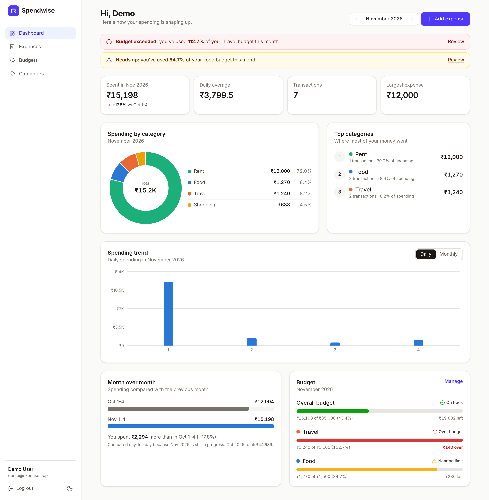
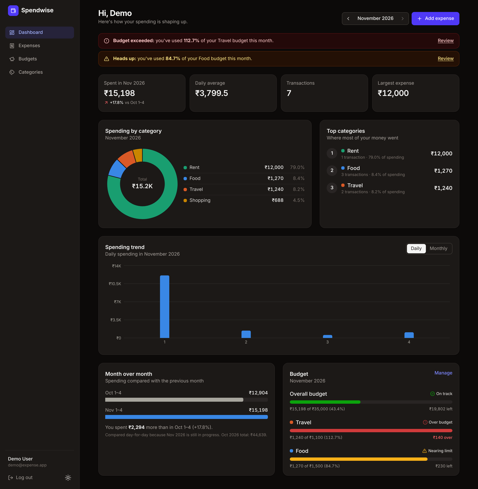
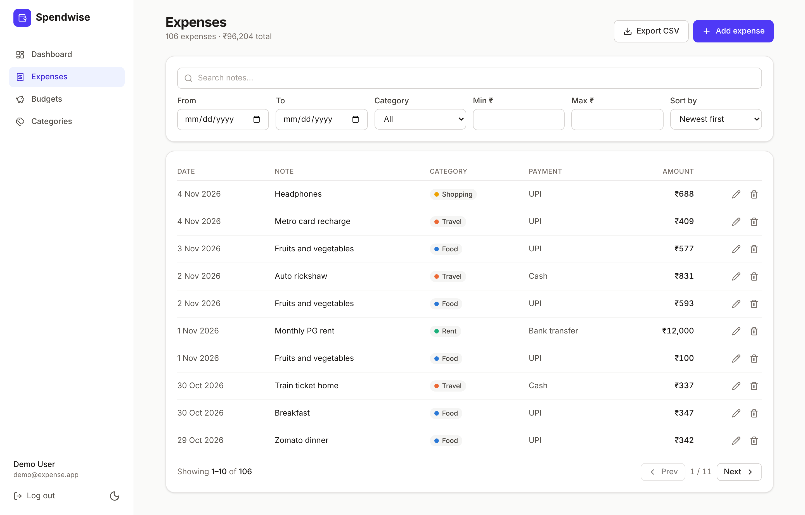
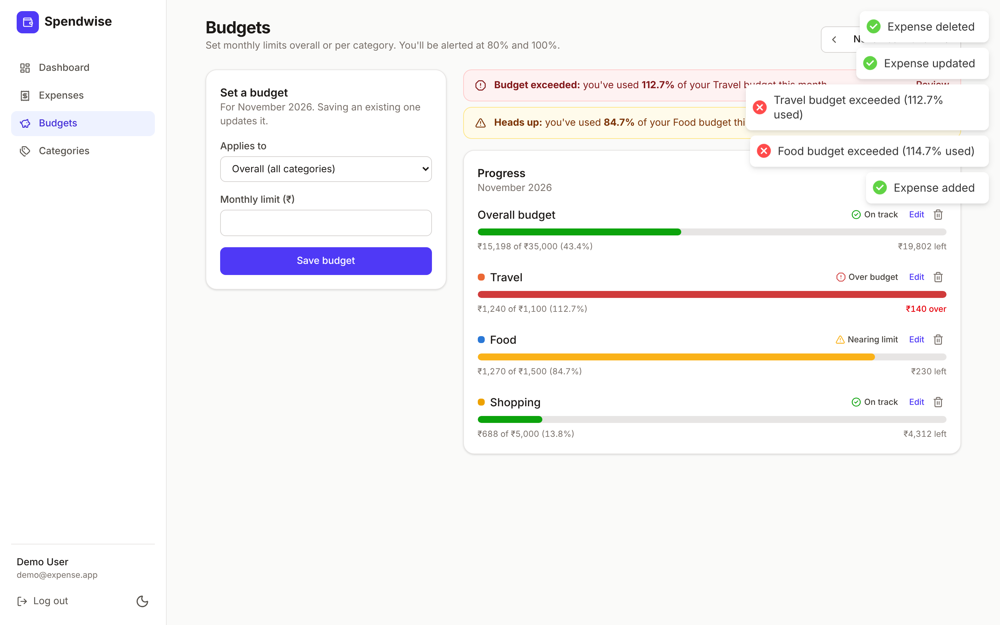
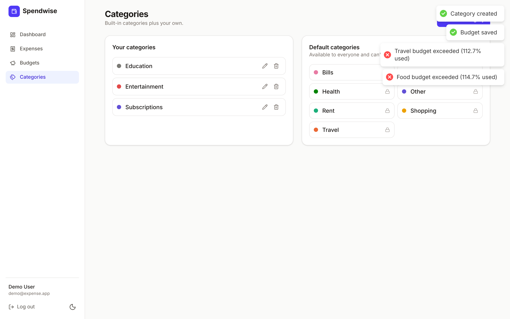
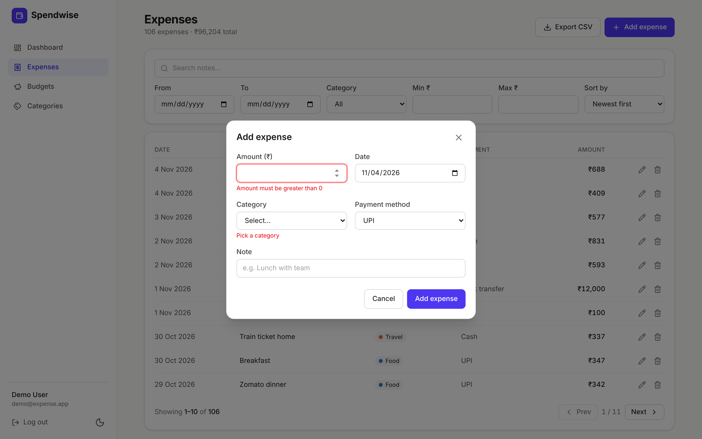
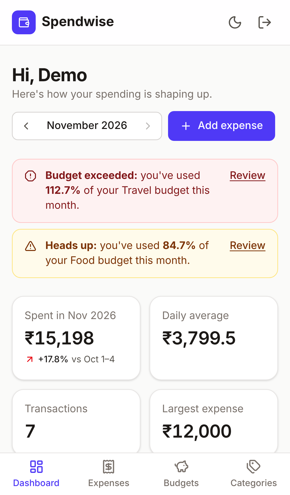
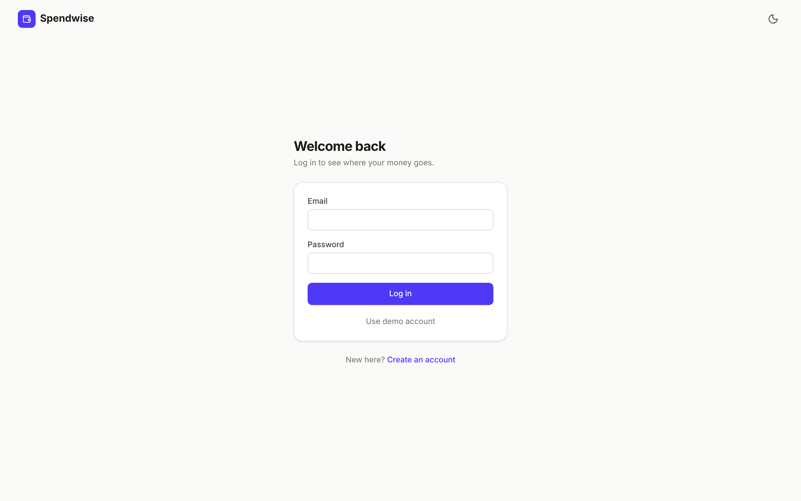

# Spendwise · Expense Tracker

[](https://github.com/jayrajkatakdhond2004-bot/Expense-tracker-/actions/workflows/ci.yml)

A full-stack expense tracker with analytics and budgets. Users log expenses, organise them into
categories, set monthly budgets with 80% / 100% alerts, and see where their money goes through a
dashboard of charts, all backed by MongoDB aggregation pipelines.

Built with **React (Vite) + Tailwind CSS + Recharts** on the frontend and **Node.js + Express +
MongoDB** on the backend, structured as an npm-workspaces monorepo.



---

## Features

**Authentication**

- Register, log in and log out, with bcrypt password hashing (12 salt rounds)
- JWT stored in an **httpOnly, `SameSite=Strict` cookie**: JavaScript can't read it (mitigates XSS
  token theft) and the browser won't send it cross-site (mitigates CSRF)
- Protected routes on the client and server; an expired session sends you back to the login page
- Login errors are identical for an unknown email and a wrong password, so accounts can't be
  enumerated

**Expenses**

- Add, edit, delete and list expenses: amount, category, date, note and payment method
- Filters for date range, category, amount range and keyword, with sorting and pagination
- Filters are kept in the URL, so a filtered view survives refresh and can be bookmarked
- **CSV export** of exactly the filtered set, with protection against CSV formula injection

**Categories**

- 7 built-in categories (Food, Travel, Rent, Shopping, Bills, Health, Other)
- Custom categories per user, with unique names (case-insensitive) and a colour picker
- A category that is still used by expenses can't be deleted

**Budgets**

- A monthly budget overall or per category
- Progress bars with status **On track / Nearing limit (≥ 80%) / Over budget (≥ 100%)**
- Alert banners on the dashboard, plus a toast when a newly added expense crosses a threshold

**Dashboard analytics**

- Monthly total, daily average, transaction count and largest expense
- Category breakdown donut with a data table
- Top 3 spending categories
- Spending trend: daily bars for a month, or a monthly line for the last 6 months
- **Month-over-month comparison.** While a month is in progress it is compared day-for-day
  (e.g. Nov 1–4 vs Oct 1–4) instead of against the whole previous month, which would be misleading

**UI/UX**

- Mobile-first responsive layout: sidebar on desktop, bottom navigation on mobile
- Dark and light mode (follows the OS setting by default and remembers your choice)
- Skeleton loaders, error states with retry, empty states and toasts
- Client-side form validation (react-hook-form + zod) that mirrors the server rules, with server
  errors mapped back onto the matching fields
- An accessible chart palette, checked for colour-vision deficiency in both themes; colour is never
  the only signal

## Tech stack

| Layer    | Technologies                                                                         |
| -------- | ------------------------------------------------------------------------------------ |
| Frontend | React 19, Vite, Tailwind CSS v4, Recharts, React Router, react-hook-form, zod, axios |
| Backend  | Node.js, Express 5, Mongoose, zod, jsonwebtoken, bcryptjs                            |
| Security | helmet, express-rate-limit, CORS allow-list, httpOnly cookies, input validation      |
| Database | MongoDB (compound indexes and aggregation pipelines)                                 |
| Testing  | Jest, Supertest, mongodb-memory-server                                               |
| Tooling  | ESLint (flat config), Prettier, GitHub Actions CI, Docker, docker-compose            |

## Screenshots

| Dashboard (dark)                                       | Expenses with filters                      |
| ------------------------------------------------------ | ------------------------------------------ |
|  |  |

| Budgets                                  | Categories                                     |
| ---------------------------------------- | ---------------------------------------------- |
|  |  |

| Form validation                                            | Mobile                                                     | Login                                |
| ---------------------------------------------------------- | ---------------------------------------------------------- | ------------------------------------ |
|  |  |  |

## Getting started

### Prerequisites

- Node.js 20+ (22 recommended; see `.nvmrc`)
- MongoDB 6+ running locally, **or** Docker (to run MongoDB in a container)

### 1. Install

```bash
git clone https://github.com/jayrajkatakdhond2004-bot/Expense-tracker-.git
cd Expense-tracker-
npm install
```

`npm install` at the root installs both workspaces (`client` and `server`).

### 2. Configure environment

```bash
cp server/.env.example server/.env
```

The defaults work for local development. Set `JWT_SECRET` to a long random string for anything
beyond local use (`openssl rand -hex 32`).

### 3. Start MongoDB

Skip this if MongoDB is already running on `localhost:27017`. Otherwise:

```bash
npm run db:up
```

### 4. Seed demo data (optional)

```bash
npm run seed
```

This creates **demo@expense.app / Demo@1234** with about 3 months of realistic expenses, two custom
categories and budgets for the current month (one of them already over the limit, so the alerts are
visible). Re-running it resets the demo user's data.

### 5. Run

```bash
npm run dev
```

- Frontend: http://localhost:5173
- API: http://localhost:5000 (the Vite dev server proxies `/api`, so the browser sees one origin)

### Run everything with Docker

```bash
docker compose up --build
```

Open http://localhost:8080. nginx serves the built frontend and proxies `/api` to the API
container. To load demo data into the containerised database:

```bash
docker compose exec server node server/src/scripts/seed.js
```

## Scripts

Run these from the repository root.

| Script           | What it does                                        |
| ---------------- | --------------------------------------------------- |
| `npm run dev`    | Starts the API (nodemon) and client (Vite) together |
| `npm test`       | Runs the Jest + Supertest API tests                 |
| `npm run lint`   | ESLint across client and server                     |
| `npm run format` | Formats the codebase with Prettier                  |
| `npm run build`  | Production build of the client                      |
| `npm run seed`   | Seeds the demo user                                 |
| `npm run db:up`  | Starts MongoDB with docker compose                  |

## API reference

Base URL: `/api/v1`. Every endpoint except the auth ones requires authentication. Responses use
a consistent envelope:

```jsonc
{ "success": true, "data": { ... } }
{ "success": false, "error": { "message": "Amount must be greater than 0", "details": [{ "field": "amount", "message": "..." }] } }
```

| Method   | Endpoint                                                     | Description                                                                                                                                                            |
| -------- | ------------------------------------------------------------ | ---------------------------------------------------------------------------------------------------------------------------------------------------------------------- |
| `POST`   | `/auth/register`                                             | Create an account and start a session                                                                                                                                  |
| `POST`   | `/auth/login`                                                | Log in (stricter rate limit: 20 requests / 15 min)                                                                                                                     |
| `POST`   | `/auth/logout`                                               | Clear the session cookie                                                                                                                                               |
| `GET`    | `/auth/me`                                                   | Current user                                                                                                                                                           |
| `GET`    | `/expenses`                                                  | List expenses. Query: `from`, `to`, `category`, `paymentMethod`, `minAmount`, `maxAmount`, `q`, `page`, `limit` (≤ 100), `sort` (`date`, `-date`, `amount`, `-amount`) |
| `POST`   | `/expenses`                                                  | Create an expense                                                                                                                                                      |
| `GET`    | `/expenses/:id`                                              | Get one expense                                                                                                                                                        |
| `PATCH`  | `/expenses/:id`                                              | Update an expense (partial)                                                                                                                                            |
| `DELETE` | `/expenses/:id`                                              | Delete an expense                                                                                                                                                      |
| `GET`    | `/expenses/export`                                           | Download filtered expenses as CSV (same filters as the list)                                                                                                           |
| `GET`    | `/categories`                                                | Default categories plus the user's own                                                                                                                                 |
| `POST`   | `/categories`                                                | Create a custom category                                                                                                                                               |
| `PATCH`  | `/categories/:id`                                            | Rename or recolour a custom category                                                                                                                                   |
| `DELETE` | `/categories/:id`                                            | Delete a custom category (`409` if expenses still use it)                                                                                                              |
| `GET`    | `/budgets?month=YYYY-MM`                                     | Budgets with `spent`, `remaining`, `percent` and `status`                                                                                                              |
| `PUT`    | `/budgets`                                                   | Create or update a budget `{ month, category \| null, limit }`                                                                                                         |
| `DELETE` | `/budgets/:id`                                               | Remove a budget                                                                                                                                                        |
| `GET`    | `/analytics/summary?month=`                                  | Total, count, daily average, largest expense, month-over-month change                                                                                                  |
| `GET`    | `/analytics/by-category?month=`                              | Per-category totals and shares, plus the top 3                                                                                                                         |
| `GET`    | `/analytics/trend?granularity=daily\|monthly&month=&months=` | Zero-filled time series                                                                                                                                                |
| `GET`    | `/health` (unversioned)                                      | Liveness and database status                                                                                                                                           |

Example:

```bash
curl -c cookies.txt -X POST localhost:5000/api/v1/auth/login \
  -H 'Content-Type: application/json' \
  -d '{"email":"demo@expense.app","password":"Demo@1234"}'

curl -b cookies.txt 'localhost:5000/api/v1/expenses?q=uber&minAmount=100&limit=5'
```

A `Authorization: Bearer <token>` header is accepted as well as the cookie, which is convenient for
API clients like Postman.

## Project structure

```
.
├── client/                     React app (Vite)
│   ├── src/
│   │   ├── api/                axios instance + one module per resource
│   │   ├── components/
│   │   │   ├── ui/             Button, Field, Modal, Card, ProgressBar, states…
│   │   │   ├── layout/         App shell (sidebar, mobile nav, theme toggle)
│   │   │   ├── charts/         CategoryDonut, TrendChart, ChartTooltip
│   │   │   ├── expenses/       ExpenseForm, ExpenseFilters, ExpenseList
│   │   │   └── budgets/        BudgetProgress, BudgetAlerts
│   │   ├── context/            AuthContext, ThemeContext
│   │   ├── hooks/              useApi, useDebounce, useCategories
│   │   ├── pages/              Dashboard, Expenses, Budgets, Categories, Login, Register
│   │   ├── routes/             ProtectedRoute / PublicOnlyRoute
│   │   └── utils/              formatting, validation schemas, colour palette
│   ├── nginx.conf              Production static server + API proxy
│   └── Dockerfile
├── server/                     Express API
│   ├── src/
│   │   ├── config/             env validation (zod), db connection, constants
│   │   ├── models/             User, Expense, Category, Budget (Mongoose)
│   │   ├── validators/         zod schemas per resource
│   │   ├── middleware/         auth, validate, rate limiter, error handler
│   │   ├── services/           business logic and aggregation pipelines
│   │   ├── controllers/        thin HTTP layer
│   │   ├── routes/v1/          versioned routers
│   │   ├── utils/              ApiError, dates, csv, clock
│   │   ├── scripts/seed.js     demo data
│   │   ├── app.js              Express app factory (used by tests)
│   │   └── server.js           entry point (DB connect, graceful shutdown)
│   ├── tests/                  Jest + Supertest
│   └── Dockerfile
├── docker-compose.yml          mongo + server + client
└── eslint.config.js            Shared lint config
```

## Design decisions

- **Layered backend.** Routes → validation middleware → controllers (HTTP only) → services
  (business logic) → models. Services don't know about `req`/`res`, which keeps them easy to test
  and reuse.
- **Validation in one place.** zod schemas parse, coerce and default every request's body, query
  and params before a controller runs. Environment variables are validated the same way at
  startup, so a misconfigured server fails fast with a clear message.
- **Centralised error handling.** Services throw `ApiError`. One error middleware turns
  `ApiError`, zod errors, Mongoose validation/cast errors and duplicate-key errors into consistent
  responses, and hides internals in production.
- **Indexes match the queries.** `{ user: 1, date: -1 }` backs the default "my expenses, newest
  first" listing and date-range filters. `{ user: 1, category: 1, date: -1 }` backs category
  filters and per-category budget and analytics aggregations. Categories use a case-insensitive
  unique index on `{ user, name }`.
- **Analytics in the database.** Each analytics endpoint is a single aggregation pipeline (`$match`
  on user and date range → `$group` → `$lookup`), rather than loading expenses into Node.
- **Data isolation.** Every query is scoped by the authenticated user's id. A user requesting
  someone else's expense gets a `404`, not a `403`, so ids can't be probed.
- **UTC dates.** Expense dates are stored as UTC midnight and grouped in UTC, so an expense dated
  "2026-11-04" always falls on that day, whatever the server's timezone.

## Testing

```bash
npm test
```

There are 24 integration tests. They run against an in-memory MongoDB (`mongodb-memory-server`),
so no database setup is needed. They cover:

- **Auth:** registration, httpOnly cookie flags, duplicate emails, validation errors, login,
  non-enumerable login errors, tampered tokens, `/me` and logout
- **Expenses:** CRUD, input validation, cross-user isolation, using another user's category,
  pagination, date-range / category / amount / keyword filters, regex-safe search and CSV export
- **Analytics and budgets:** monthly summary, category breakdown, daily and monthly trends,
  day-for-day comparison for the in-progress month, and budget status thresholds

The first test run downloads a MongoDB binary (about 100 MB), which is then cached.

## Environment variables

Set these in `server/.env`; see `server/.env.example`.

| Variable              | Default                 | Description                                     |
| --------------------- | ----------------------- | ----------------------------------------------- |
| `NODE_ENV`            | `development`           | `development` / `production` / `test`           |
| `PORT`                | `5000`                  | API port                                        |
| `MONGO_URI`           | required                | MongoDB connection string                       |
| `JWT_SECRET`          | required (≥ 16 chars)   | Secret used to sign tokens                      |
| `JWT_EXPIRES_IN`      | `7d`                    | Token lifetime                                  |
| `CLIENT_URL`          | `http://localhost:5173` | Comma-separated CORS allow-list                 |
| `COOKIE_SECURE`       | `true` in production    | Send the cookie over HTTPS only                 |
| `RATE_LIMIT_MAX`      | `300`                   | Requests per 15 minutes per IP (all API routes) |
| `AUTH_RATE_LIMIT_MAX` | `20`                    | Requests per 15 minutes per IP (login/register) |

## Possible improvements

- Recurring expenses (rent, subscriptions) generated automatically
- Refresh-token rotation and a "log out of all devices" option
- Multi-currency support with conversion
- End-to-end tests with Playwright in CI
